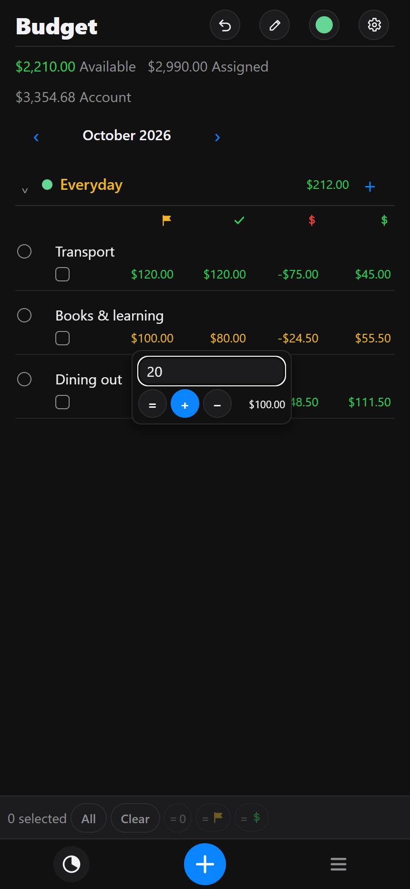
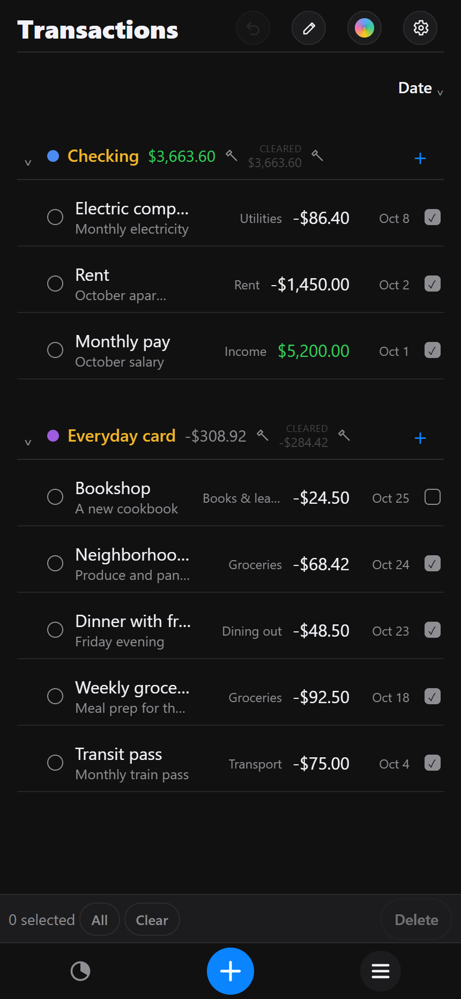
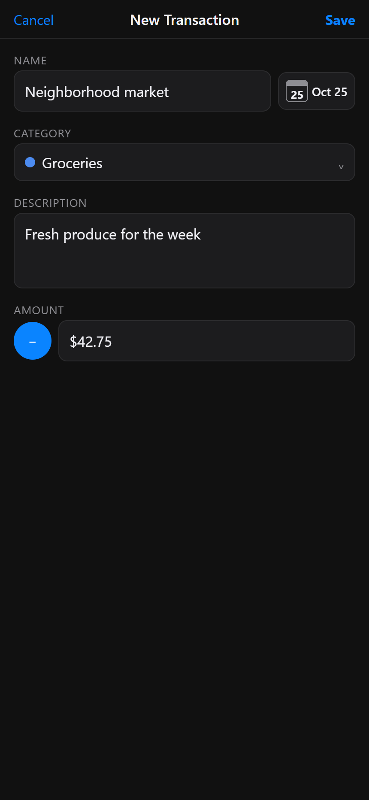

# AcctMind

A ledger: transactions by account, and a two-level budget.

## Disclaimer

Feel free to deploy this on your own website, build and deploy the iOS version, etc.

**This is a personal project to have some fun with claude code, which generated essentially all of the code, and the rest of this readme:**

## Quick start / Install

- macOS (Apple silicon) and Windows: installers on the [AcctMind releases](https://github.com/chere005/MindSuite/releases?q=AcctMind) of the MindSuite repository (pick the newest `AcctMind/<version>`). The Mac app is signed with Developer ID and notarized; the Windows installers are not code-signed, so SmartScreen warns once. Both update themselves: choose **Check for Updates** in the app's menu (AcctMind never checks in the background).
- Web, iOS and Android: build from source, see Building. The web build signs in with a CalMind account.

## Platforms

- Web
- iOS and Android
- macOS and Windows (Tauri desktop app)

## Usage

### Budget

Categories with lines under them. Adjust an allocation and see its target, spent and remaining.

<picture></picture>

### Transactions

Income and expenses by account, with dates, categories, balances and cleared status.

<picture></picture>

### Add a transaction

Name, date, category, description, amount.

<picture></picture>

## Notes

- No server, no database. The device holds the ledger.
- Optional sync: iPhone and iPad over the local network; iPhone and Mac through one file in iCloud Drive; the web app reads the iPhone's copy through CloudKit after an Apple ID sign-in. Windows and Android do not sync.
- One TypeScript core (`packages/core`) shared by every platform.

## Building

```sh
npm install
npm run web          # Expo web on :8083
npm run test:dev     # under a minute, no browser
npm test             # everything
```

Deploy: copy `deploy.conf.sample` to `deploy.conf`, then `./deploy.sh` (sandbox, then production). Release: `npm run dtp` (or `tdtp`, tests first); the tag builds the installers on GitHub, and a `--mac` run also publishes the signed update feed (AGENTS.md).

## Documentation

- [ARCHITECTURE.md](ARCHITECTURE.md): every screen, where data lives, sync, each platform, releases.
- [TESTING.md](TESTING.md): what the tests cover.
- [AGENTS.md](AGENTS.md): rules for anyone, human or agent, changing the code.

## Contributing

Issues and pull requests are welcome. Read AGENTS.md first; `npm test` must pass. BSD 3-Clause, see [LICENSE](LICENSE).
